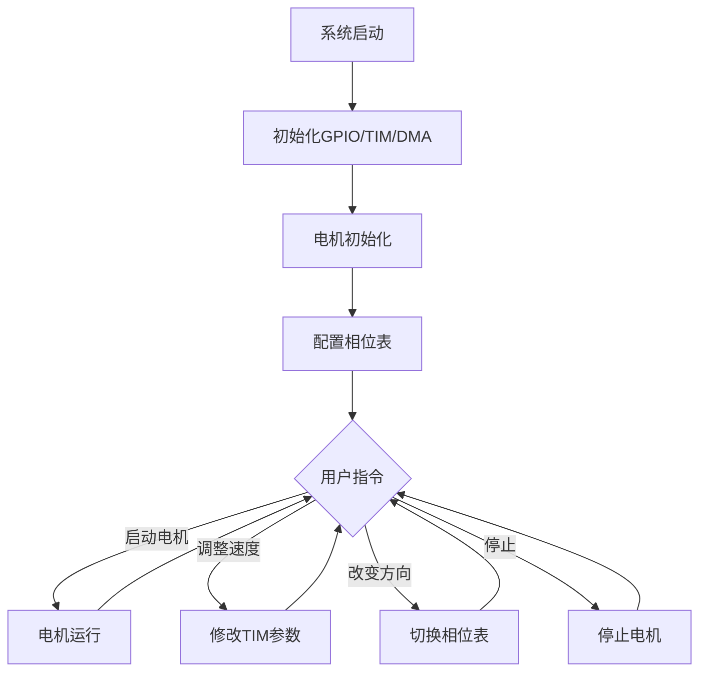
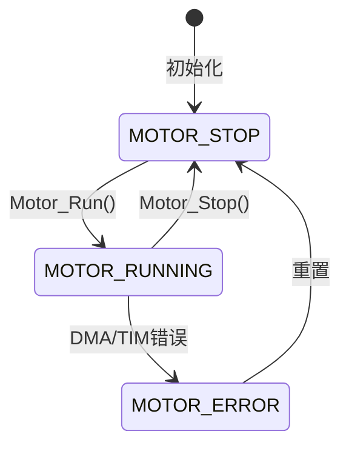
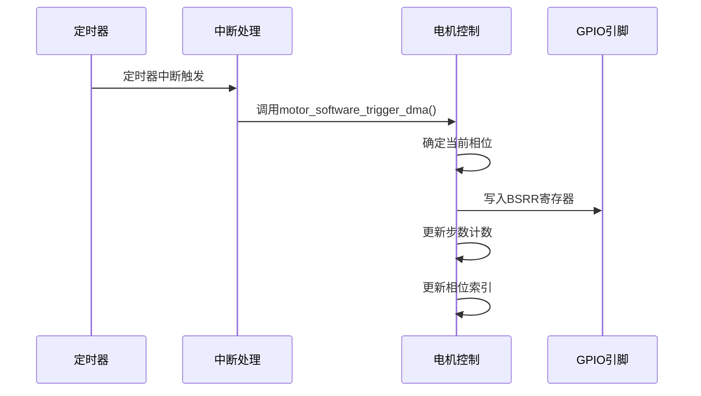
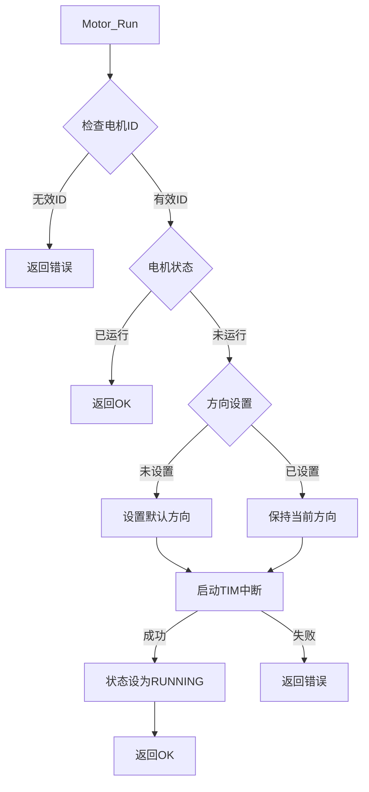
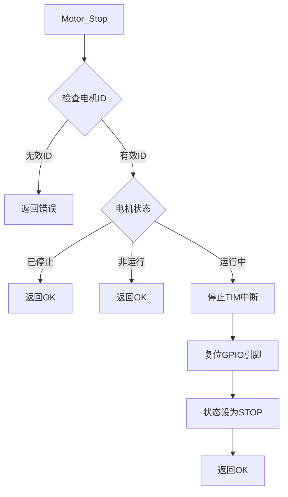
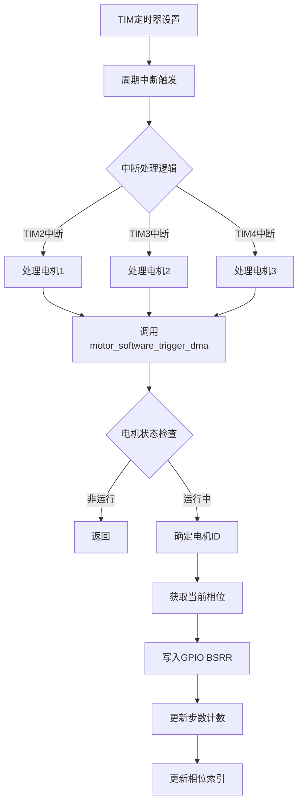
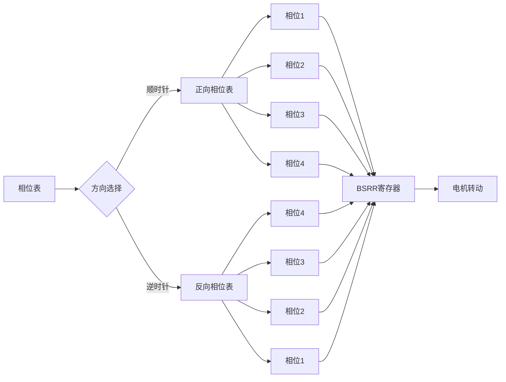
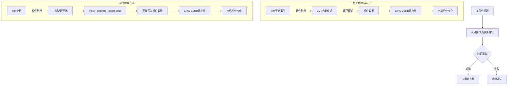
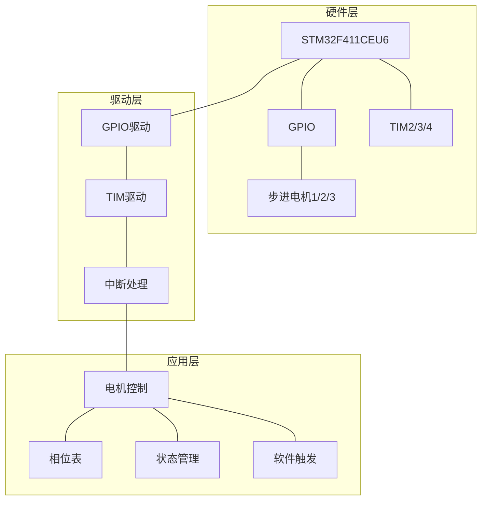

# 六面顶压机电机控制系统

## 项目简介

本项目基于STM32F411CEU6实现六面顶压机的控制系统，通过步进电机驱动三个顶，实现自动化控制。每个步进电机采用五线四相方式驱动，通过丝杆推动顶锤前进。

## 硬件配置

- 主控芯片：STM32F411CEU6
- 电机数量：3个步进电机
- 电机接口：五线四相步进电机
- 步进电机连接方式：
  - 电机1: TIM2 + DMA1_Stream6
    - PA10, PA11, PA12, PA15
  - 电机2: TIM3 + DMA1_Stream2
    - PA0, PA1, PA2, PA3
  - 电机3: TIM4 + DMA1_Stream7
    - PB3, PB4, PB5, PB6

## 软件设计

### 电机控制状态机

电机控制采用状态机设计，主要状态包括：
- 停止（MOTOR_STOP）
- 运行（MOTOR_RUNNING）
- 错误（MOTOR_ERROR）

### 流程图

#### 系统总体流程



#### 电机控制状态机



#### 软件触发模式流程



#### 电机启动流程



#### 电机停止流程



#### 软件DMA实现原理



#### 相位控制详细流程



#### 硬件DMA到软件触发转换流程



#### 完整系统架构



### 控制流程

1. **初始化流程**
   - 系统初始化：配置时钟、GPIO、TIM和DMA
   - 电机初始化：配置相位表、复位所有引脚、设置初始状态

2. **电机启动流程**
   - 检查电机ID是否有效
   - 如果电机未运行，配置相位（默认顺时针）
   - 配置DMA为非循环模式
   - 启动定时器中断（不再使用DMA自动触发）
   - 设置电机状态为运行

3. **电机控制流程**
   - 定时器周期性中断
   - 在中断处理函数中直接通过软件控制相位变化
   - 使用GPIO的BSRR寄存器直接控制电机相位
   - 根据旋转方向更新步数计数器
   - 循环更新相位索引

4. **电机停止流程**
   - 停止定时器中断
   - 复位GPIO引脚状态
   - 设置电机状态为停止

5. **方向控制流程**
   - 根据指定方向设置相位表
   - 如果电机正在运行，动态切换相位并保持平滑过渡

6. **速度控制流程**
   - 通过调整定时器的分频系数和自动重装值控制速度
   - 使用二分查找确定最优定时器参数

### 软件触发DMA模式

由于硬件DMA触发在STM32F411CEU6上不能正常工作，系统改为使用纯软件控制方式：

1. 定时器产生周期性中断
2. 在中断处理函数中，直接将相位数据写入GPIO的BSRR寄存器
3. 电机相位按照预定相序循环变化，实现电机转动

### 主要函数介绍

- `Motor_InitAll()`：初始化所有电机
- `Motor_Run()`：启动指定电机
- `Motor_Stop()`：停止指定电机
- `Motor_EmergencyStop()`：紧急停止所有电机
- `Motor_SetDir()`：设置电机旋转方向
- `Motor_SetSpeed()`：设置电机速度
- `motor_software_trigger_dma()`：软件触发相位更新

## 优化说明

本系统原计划使用TIM定时器通过DMA硬件自动传输相位数据到GPIO的BSRR寄存器，但在STM32F411CEU6上遇到兼容性问题，通过以下测试确定：

1. 通过WritePin函数直接操控GPIO可以正常工作
2. 通过BSRR寄存器操控GPIO可以正常工作
3. 手动赋值相位表到BSRR可以正常工作
4. TIM中断可以正常产生并执行中断函数
5. DMA中断未能正常触发

最终解决方案是使用定时器中断+软件相位控制方式，直接在中断函数中控制GPIO相位变化，不再依赖DMA硬件自动传输。这种方式可靠性更高，且在STM32F411CEU6上可以正常工作。

## 系统概述
本系统实现六面顶压机中碳转石墨过程的实时监控与控制，集成3D可视化界面与精确参数控制。

## 核心功能
- **工艺控制**：压力温度实时监控，精确控制
- **可视化**：3D模型实时显示，动态粒子效果
- **数据管理**：过程记录，参数导出
- **智能预警**：故障诊断，安全监测

## 技术参数
- **压力范围**：0-10GPa (±0.1GPa)
- **温度范围**：0-200℃ (±1℃)
- **显示屏**：128x64 OLED
- **控制器**：STM32F407VGT6

## 操作指南
- **按键功能**
  - ↑↓：菜单选择
  - OK：确认/进入
  - ESC：返回/取消
  - 长按：快速调节

## 步进电机配置
### 硬件接口
```
motor1 (TIM2 + DMA1_Stream6)
- A:PA10  B:PA11  C:PA12  D:PA15

motor2 (TIM3 + DMA1_Stream2)
- A:PA0   B:PA1   C:PA2   D:PA3

motor3 (TIM4 + DMA1_Stream7)
- A:PB3   B:PB4   C:PB5   D:PB6
```

### 性能参数
- 速度：10-1000步/秒
- 驱动方式：4相8拍
- 控制方式：DMA循环驱动
- 实时监控：位置、速度、状态

## 软件架构
```
项目结构
├── system/    # 系统核心
├── driver/    # 硬件驱动
└── app/       # 应用层
```

## 版本信息
- 当前版本：v1.0.1 (2024-03)
- 更新内容：优化显示，夜间模式，交互改进

## 技术支持
- 文档：[在线文档链接]
- 反馈：[问题反馈链接]
- 维护：[维护指南链接] 

## 菜单系统使用说明

### 在main.c中使用菜单系统

1. 初始化菜单系统
```c
#include "menu.h"

int main(void)
{
    // 系统初始化
    System_Init();
    
    // 初始化菜单系统
    Menu_Init();
    
    // 进入主菜单
    menu_main();
    
    while(1)
    {
        // 主循环
    }
}
```

2. 菜单系统功能说明
- `menu_main()`: 进入主菜单界面
- `menu1()`: 显示主菜单选项
- `menu2()`: 显示参数设置菜单
- `menu3_*()`: 各种参数设置子菜单
- `menu4_*()`: 系统配置子菜单

3. 菜单操作说明
- 按键1: 向上选择
- 按键2: 向下选择
- 按键3: 确认/进入
- 按键4: 返回/退出

4. 菜单功能列表
- 压力设置 (menu3_PressureSet)
- 温度设置 (menu3_TemperatureSet)
- 时间设置 (menu3_TimeSet)
- 工艺选择 (menu3_ProcessSelect)
- 数据记录 (menu3_DataRecord)
- 系统配置 (menu3_SystemConfig)
- 电机状态 (menu_motor_status)

5. 注意事项
- 使用菜单系统前需要确保按键和OLED显示已正确初始化
- 菜单系统会占用部分RAM和Flash空间
- 建议在系统空闲时调用菜单系统
- 菜单操作会暂时阻塞主循环，建议在非关键任务时使用 

## OLED显示汉字字模列表

以下为系统中使用的所有中文字符，用于字模提取：

```
工艺监控参数设置历史记录
压力温度时间选择数据系统
配置电机状态校准报警信息
记录导出功能未实现精细
调节粗略分钟小时顶序
自定义硬件软件号转化
进给量速度
```