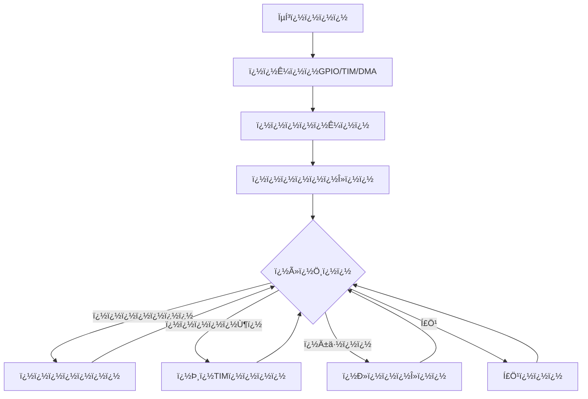
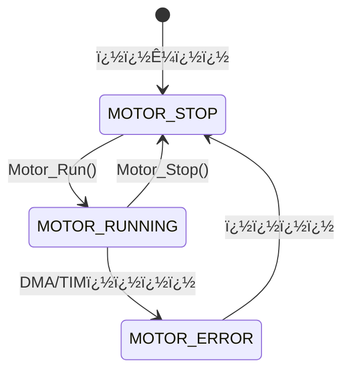
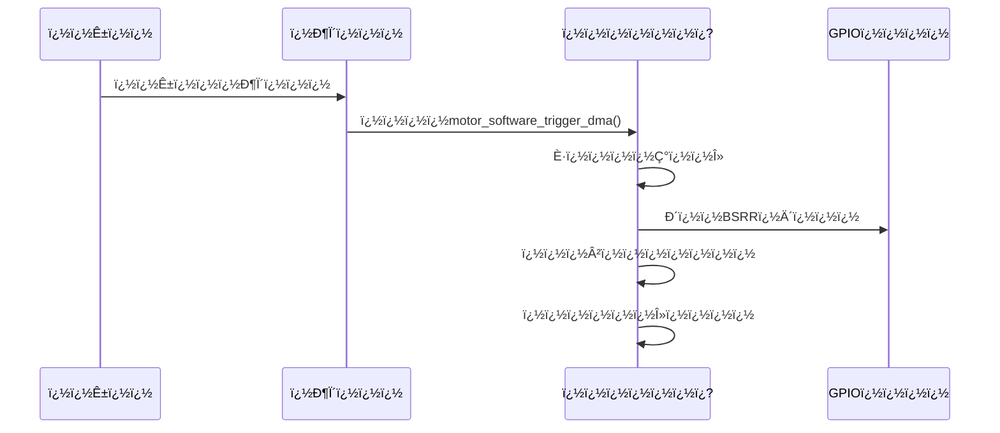
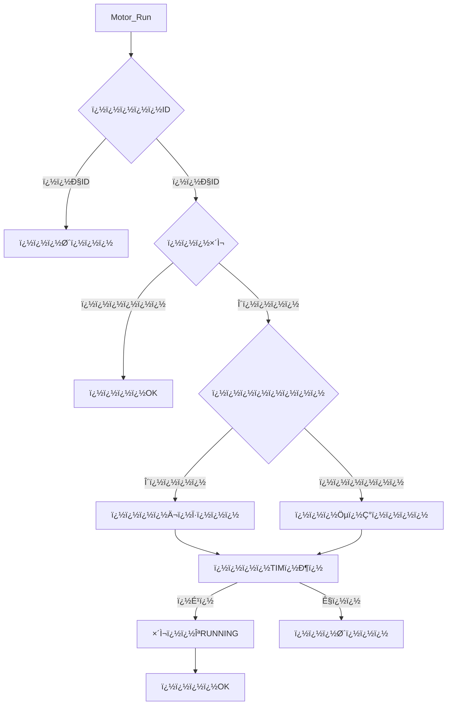
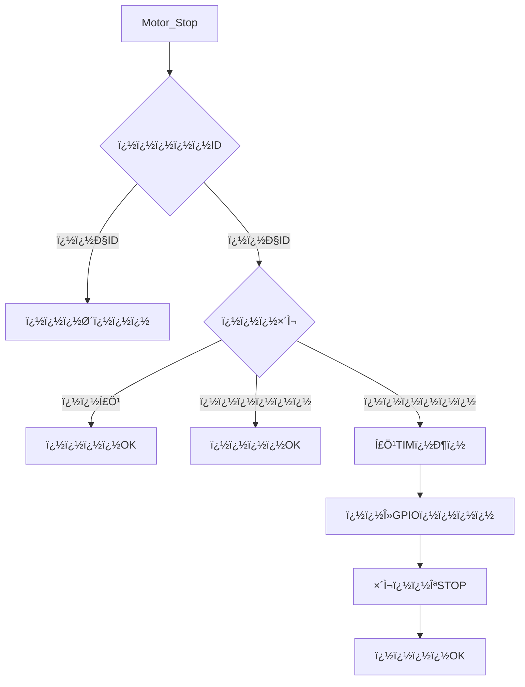
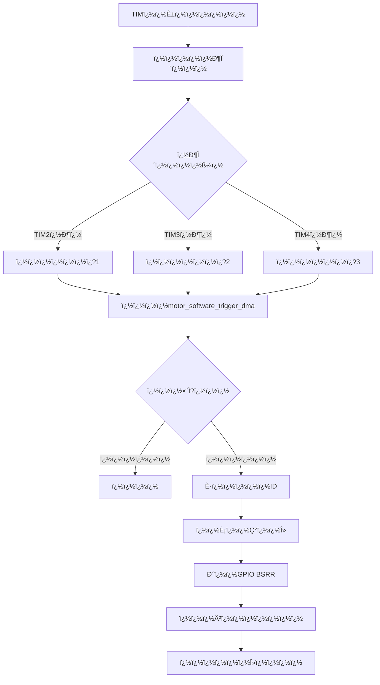
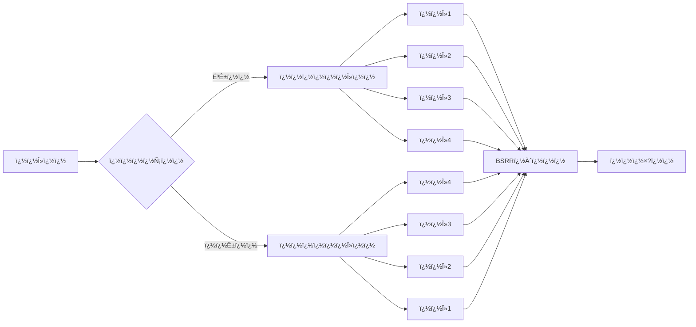
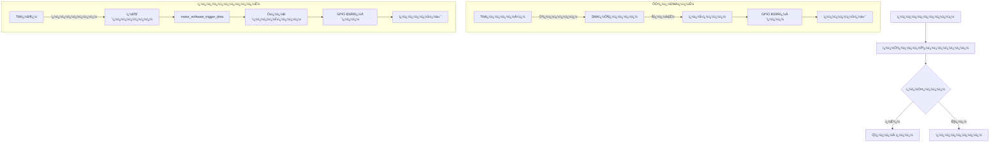
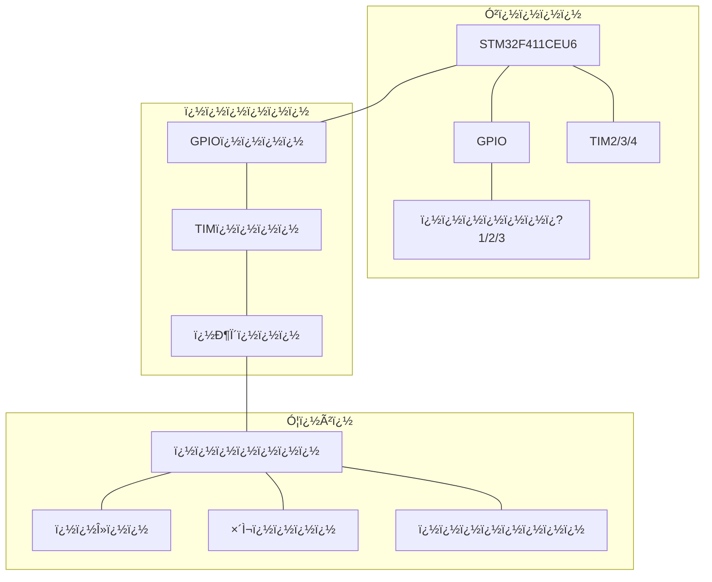

# ���涥ѹ���������ϵÍ?

## ��Ŀ���

����Ŀ����STM32F411CEU6ʵ�����涥ѹ���Ŀ���ϵͳ��ͨ���������������������ʵ���Զ������ơ�ÿ��������������������෽ʽ������ͨ��˿���ƶ�����ǰ����

## Ӳ������

- ����оƬ��STM32F411CEU6
- ���������3���������
- ����ӿڣ��������ಽ�����
- ����������ӷ�ʽ��
  - ���1: TIM2 + DMA1_Stream6
    - PA10, PA11, PA12, PA15
  - ���2: TIM3 + DMA1_Stream2
    - PA0, PA1, PA2, PA3
  - ���3: TIM4 + DMA1_Stream7
    - PB3, PB4, PB5, PB6

## �������

### �������״Ì?��

������Ʋ���״Ì?����ƣ���Ò?״̬������
- ֹͣ��MOTOR_STOP��
- ����MOTOR_RUNNING��
- ����MOTOR_ERROR��

### ����ͼ

#### ϵͳ��������



#### �������״Ì?��



#### ��������ģʽ����



#### �����������



#### ���ֹͣ����



#### ����DMAʵ��ԭ��



#### ��λ������ϸ����



#### Ӳ��DMA����������ת������



#### ����ϵͳ�ܹ�



### ��������

1. **��ʼ������**
   - ϵͳ��ʼ��������ʱ�ӡ�GPIO��TIM��DMA
   - �����ʼ����������λ������λ�������š����ó�ʼ״Ì?

2. **�����������**
   - �����ID�Ƿ���Ч
   - ������δ���У�������λ��Ĭ��˳ʱ�룩
   - ����DMAΪ��ѭ��ģʽ
   - ������ʱ���жϣ�����ʹ��DMA�Զ�������
   - ���õ��״Ì?����

3. **�����������**
   - ��ʱ���������ж�
   - ���жϴ���������ֱ��ͨ������������λ�仯
   - ʹ��GPIO��BSRR�Ĵ���ֱ�ӿ��Ƶ����Î?
   - ������ת������²���������
   - ѭ��������λ����

4. **���ֹͣ����**
   - ֹͣ��ʱ���ж�
   - ��λGPIO����״̬
   - ���õ��״Ì?Ϊֹͣ

5. **�����������**
   - ����ָ������������λ��
   - �������������У���̬�л���λ������ƽ������

6. **�ٶȿ�������**
   - ͨ��������ʱ���ķ�Ƶϵ�����Զ���װֵ�����ٶ�
   - ʹ�ö��ֲ���ȷ�����Ŷ�ʱ������

### ��������DMAģʽ

����Ӳ��DMA������STM32F411CEU6�ϲ�������������ϵͳ��Ϊʹ�ô��������Ʒ�ʽ��

1. ��ʱ�������������ж�
2. ���жϴ��������У�ֱ�ӽ���λ����д��GPIO��BSRR�Ĵ���
3. �����λ����Ԥ������Ñ?���仯��ʵ�ֵ��×?��

### ��Ҫ��������

- `Motor_InitAll()`����ʼ�����е��
- `Motor_Run()`������ָ�����
- `Motor_Stop()`��ָֹͣ�����
- `Motor_EmergencyStop()`������ֹͣ���е��
- `Motor_SetDir()`�����õ����×?����
- `Motor_SetSpeed()`�����õ���ٶ�
- `motor_software_trigger_dma()`���������������

## �Ż�˵��

��ϵͳԭ�ƻ�ʹ��TIM��ʱ��ͨ��DMAӲ���Զ�������λ���ݵ�GPIO��BSRR�Ĵ���������STM32F411CEU6���������������⣬ͨ�����²���ȷ����

1. ͨ��WritePin����ֱ�Ӳٿ�GPIO������������
2. ͨ��BSRR�Ĵ����ٿ�GPIO������������
3. �ֶ���ֵ��λ����BSRR������������
4. TIM�жϿ�������������ִ���жϺ���
5. DMA�ж�δ����������

���ս��������ʹ�ö�ʱ���ж�+������λ���Ʒ�ʽ��ֱ�����жϺ����п���GPIO��λ�仯����������DMAӲ���Զ����䡣���ַ�ʽ�ɿ��Ը��ߣ�����STM32F411CEU6�Ͽ�������������

## ϵͳ����
��ϵͳʵ�����涥ѹ����̼תʯī���̵�ʵʱ�������ƣ�����3D���ӻ������뾫ȷ�������ơ�

## ������
- **���տ���**��ѹ���¶�ʵʱ��أ���ȷ����
- **���ӻ�**��3Dģ��ʵʱ��ʾ����̬����Ч��
- **���ݹ���**�����̼�¼����������
- **����Ԥ��**��������ϣ���È?��ï¿?

## ��������
- **ѹ����Χ**��0-10GPa (��0.1GPa)
- **�¶ȷ�Χ**��0-200�� (��1��)
- **��ʾ��**��128x64 OLED
- **������**��STM32F407VGT6

## ����ָ��
- **��������**
  - �������˵�ѡ��
  - OK��ȷ��/����
  - ESC������/ȡ��
  - ���������ٵ���

## �����������
### Ӳ���ӿ�
```
motor1 (TIM2 + DMA1_Stream6)
- A:PA10  B:PA11  C:PA12  D:PA15

motor2 (TIM3 + DMA1_Stream2)
- A:PA0   B:PA1   C:PA2   D:PA3

motor3 (TIM4 + DMA1_Stream7)
- A:PB3   B:PB4   C:PB5   D:PB6
```

### ���ܲ���
- �ٶȣ�10-1000��/��
- ������ʽ��4��8��
- ���Ʒ�ʽ��DMAѭ������
- ʵʱ��أ�λ�á��ٶȡ�״Ì?

## �����ܹ�
```
��Ŀ�ṹ
������ system/    # ϵͳ����
������ driver/    # Ӳ������
������ app/       # Ӧ�ò�
```

## �汾��Ϣ
- ��ǰ�汾��v1.0.1 (2024-03)
- �������ݣ��Ż���ʾ��ҹ��ģʽ�������Ľ�

## ����֧��
- �ĵ���[�����ĵ�����]
- ������[���ⷴ������]
- ά����[ά��ָ������] 

## �˵�ϵͳʹ��˵��

### ��main.c��ʹ�ò˵�ϵͳ

1. ��ʼ���˵�ϵͳ
```c
#include "menu.h"

int main(void)
{
    // ϵͳ��ʼ��
    System_Init();
    
    // ��ʼ���˵�ϵͳ
    Menu_Init();
    
    // �������˵�
    menu_main();
    
    while(1)
    {
        // ��ѭ��
    }
}
```

2. �˵�ϵͳ����˵��
- `menu_main()`: �������˵�����
- `menu1()`: ��ʾ���˵�ѡ��
- `menu2()`: ��ʾ�������ò˵�
- `menu3_*()`: ���ֲ��������Ӳ˵�
- `menu4_*()`: ϵͳ�����Ӳ˵�

3. �˵�����˵��
- ����1: ����ѡ��
- ����2: ����ѡ��
- ����3: ȷ��/����
- ����4: ����/�˳�

4. �˵������б�
- ѹ������ (menu3_PressureSet)
- �¶����� (menu3_TemperatureSet)
- ʱ������ (menu3_TimeSet)
- ����ѡ�� (menu3_ProcessSelect)
- ���ݼ�¼ (menu3_DataRecord)
- ϵͳ���� (menu3_SystemConfig)
- ���״Ì? (menu_motor_status)

5. ע������
- ʹ�ò˵�ϵͳǰ��Ҫȷ��������OLED��ʾ����ȷ��ʼ��
- �˵�ϵͳ��ռ�ò���RAM��Flash�ռ�
- ������ϵͳ����ʱ���ò˵�ϵͳ
- �˵���������ʱ������ѭ���������ڷǹؼ�����ʱʹ�� 

## OLED��ʾ������ģ�б�

����Ϊϵͳ��ʹ�õ����������ַ���������ģ��ȡ��

```
���ռ�ز���������ʷ���
ѹ���¶�ʱ��ѡ������ϵͳ
���õ��״Ì?У׼������Ϣ
��¼��������δʵ�־�ϸ
���ڴ��Է���Сʱ����
�Զ���Ӳ��������ת��
�������ٶ�
```

ÏÔʾģÐÍѹÁ¦ÌõÐÎͼζȼƺÍÖµ½ø°Ù·Ö±Èϵͳ״À¸²ËÏîÓÐЧÊý¾¯¸æЧ¹û¸ü
¸üÐÂÁ£×Ó³õʼ»¯Çл»°×ÌìÒ¹Ííģʽ׼±¸½×¶Î¼ÓÈÈѹ³ÖÀäÈ´Íê³É·½ÏòËÙ¶È


Õý¼ä±£¶ÁÈ¡»º¶¯ÉèÖÃÔËÐÐÍ£Ö¹²ÎÊýÖ÷Ð޸IJ½Ðýת²âÊÔµ÷Ö±¹â±êÁÁ¶È´¥Ãþ°´¼üÁéÃôÉù¹ØÒôÏÞ
µç·Çý»ñÇ°ºó×óÓÒͨµÀ¼ÀúÊ·¹ÌÑ¡È·¸ßµÍÈíÓ²°æ±¾ºÅλʱ¿ØÖÆ»ú½ô¼±¶¥ÒÕÁùÈÎÒâ

¼à¿Ø¼ÇÃæÆô·µ»ØÈÏÈ¡ÏûÔÚÖÐÇëÏÈËùÒÑÈÈÔñ¾ÝÅ伶ÐÅÈ«²¿ÔÝÎÞ×ÔУ¼þ·½ÖÓС